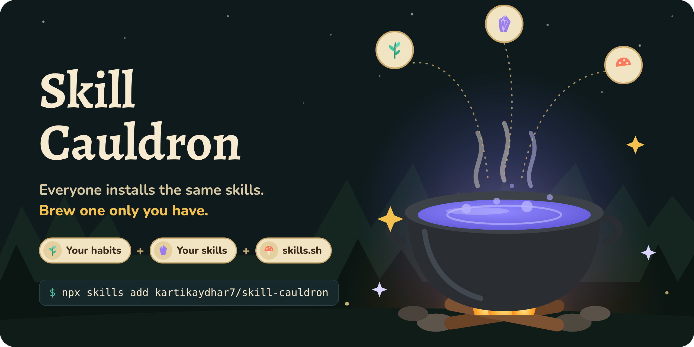
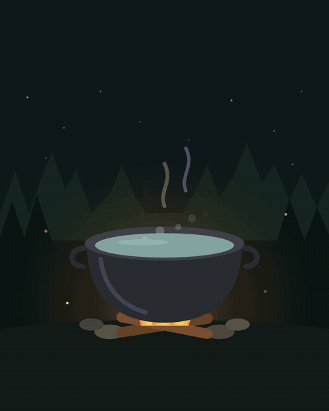
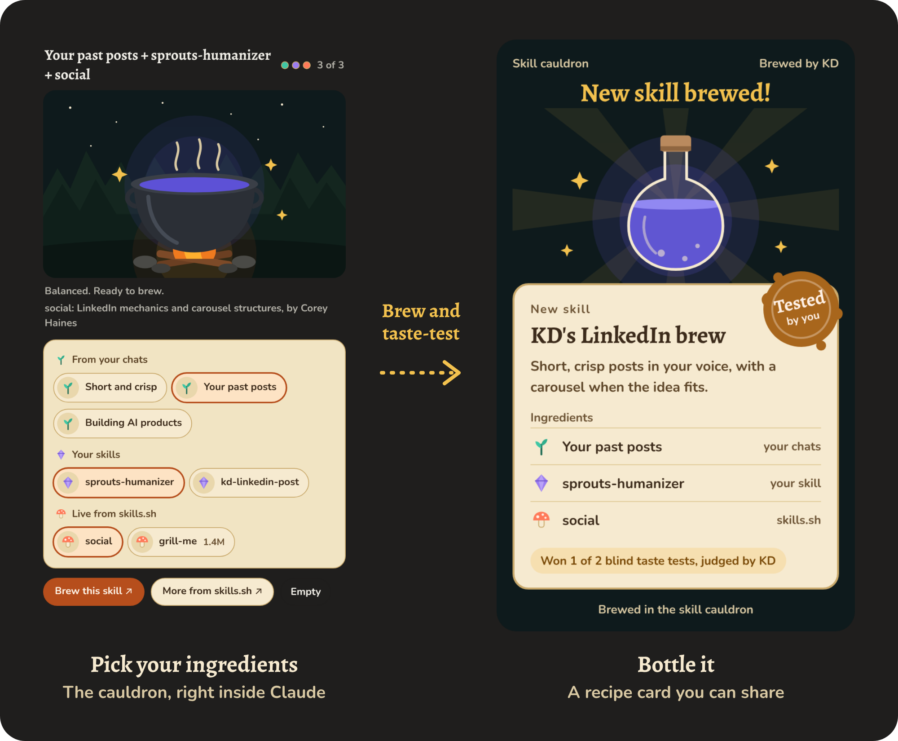

<p align="center"></p>

# Skill Cauldron

Brew your own Claude skill from your habits, the skills you already use, and live skills from skills.sh.

First came prompt engineering, our way of keeping AI ours. Prompts didn't cut it, so we got MCPs, plugins and skills. Now we all install the same ones. Skill Cauldron mixes a few of them with how you actually work, so you end up with a skill nobody else has.

## See it brew

<p align="center"></p>

## Install

```
npx skills add kartikaydhar7/skill-cauldron
```

Or copy `skills/skill-cauldron` into your skills folder (for Claude Code, `~/.claude/skills/`).

## How it works

<p align="center"></p>

1. **Gather.** Three rows of ingredients: habits from your past chats, skills you already have, and live skills from skills.sh.
2. **Mix.** Tap ingredients into the cauldron. Three is balanced. Past three the potion turns murky, because in SkillsBench the gain from skills shrank from +18.6 points (two or three skills) to +5.9 (four or more).
3. **Brew.** Claude writes one lean skill from what you picked, with your habits taking precedence.
4. **Taste-test.** A blind A/B test that you judge, with and without the new skill.
5. **Bottle.** You get the skill plus a shareable recipe card with its ingredients and the test result.

Ask for a skill DNA card instead and it maps your habits and suggests what to brew.

To start, tell Claude something like "brew me a skill for my weekly updates".

## Credits

- [SkillsBench: Benchmarking How Well Agent Skills Work Across Diverse Tasks](https://arxiv.org/abs/2602.12670)
- [skills.sh](https://skills.sh), the open directory of agent skills

## License

MIT
